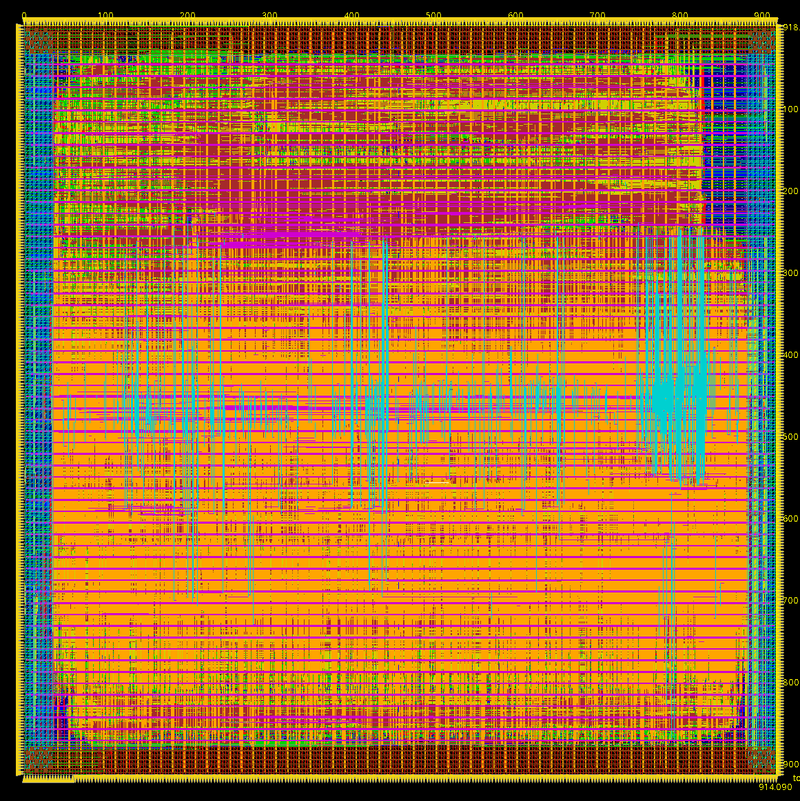

# Final Project: ECDSA Signature Engine on secp256k1

Term project for EE4292 IC Design Laboratory (Fall 2024), by a two-person team:

- **Yu-Shuo Chang (張育碩)**: elliptic-curve arithmetic and APR (place-and-route)
- **黃玄彰**: SHA-256, signing, and top-level integration

The engine takes a message and a private key and produces an **ECDSA signature on curve secp256k1** (the Bitcoin curve). The interface is AXI-Stream, and the design was taken from RTL through synthesis, LEC, and place-and-route.

<p align="center">
  <br>
  <em>ECDSA engine after APR</em>
</p>

## Architecture

```
message ──► SHA-256 ──────────────► e ─┐
                                       ├─► signing:  s = k⁻¹(e + r·d) mod n ──► (r, s)
nonce k ──► ECC scalar mult (k·G) ─► r ┘
```

| Block | Files | Author |
|---|---|---|
| **ECC scalar multiplication** (Montgomery ladder) | `ECC_top.v`, `montgomery_ladder.v` | Chang |
| Point addition / point doubling | `ECPA.v`, `ECPD.v`, `CSA_ECPA.v` | Chang |
| Modular arithmetic over the secp256k1 prime | `mod_add.v`, `mod_sub.v`, `mod_mul.v`, `mod_inv.v`, `pipeline_add_sub.v`, `secp256k1_mod.v`, `karatsuba_multiply.v` | Chang |
| Carry-save (CSA) versions of the modular operators, for timing | `CSA_mod_add.v`, `CSA_mod_sub.v`, `CSA_mod_mul.v`, `CSA_mod_inv.v` | 黃玄彰 |
| SHA-256 hashing (and an earlier SHA-1) | `sha256_*.v`, `sha1_*.v` | 黃玄彰 |
| Signing and top level | `signing.v`, `ECDSA_top.v`, `ECDSA_wrapper.v`, `post_ML.v` | 黃玄彰 |
| **APR** (place-and-route, layout below) | — | Chang |

The Montgomery-ladder scalar multiplication does a point addition and a point doubling on every key bit, whatever the bit's value. Its timing therefore does not depend on the private key, which resists timing and simple power analysis.

## Folder layout

- `hdl/`: RTL
- `sim/`: one testbench per block. Python pattern generators and golden models produce the vectors (`*_Pattern_Generator.py`), and `ECDSA_TB_Verification*.py` checks full signatures.
- `script/`: SpyGlass lint setup
- `syn/`: Design Compiler scripts
- `report.pdf`: design write-up and results

Synthesized netlists, SDF files, and the LEC and Innovus databases are not included. Generated test vectors can be rebuilt with the Python generators.

## Tools

- Verilog
- Python (golden model)
- Synopsys VCS
- SpyGlass
- Design Compiler
- Cadence Conformal LEC
- Cadence Innovus
